# DeliveryProof Intelligent Contract 🚚❄️

A production-grade **GenLayer Intelligent Contract primitive** providing autonomous, multi-modal supply chain escrow settlement. `DeliveryProof` combines value-backed native token escrows, real-time IoT cold-chain temperature telemetry verification, carrier delay calculations, and AI-powered dispute resolution validated by decentralized consensus validators.

Deployed on **GenLayer StudioNet** at [`0x2FcD9bbbad3d37b39BC440d9d0cAe34Ac9f9d6f8`](https://genlayer-explorer.vercel.app/address/0x2FcD9bbbad3d37b39BC440d9d0cAe34Ac9f9d6f8).

---

## Key Highlights & Architectural Guarantees

1. **Pinned GenVM Runner**:
   - Pinned on Line 1 to the concrete release runner hash:
     ```python
     # { "Depends": "py-genlayer:1jb45aa8ynh2a9c9xn3b7qqh8sm5q93hwfp7jqmwsfhh8jpz09h6" }
     ```
2. **Value-Backed Payable Escrow & Carrier Bond (`@gl.public.write.payable`)**:
   - Strictly enforces native value transfers. Never credits arbitrary integer parameters.
   - `deposit_funds()`, `create_shipment()`, and `stake_carrier_bond()` all read `gl.message.value` and revert if insufficient native funds are supplied.
3. **Real Native Withdrawal Path (`withdraw`)**:
   - Implements strict Checks-Effects-Interactions (CEI).
   - Credits native transfers via `gl.ContractAt(sender).emit_transfer(value=amount)`.
4. **Anti-Partisan Timelock Clock (`advance_epoch`) & Mutual Waiver (`waive_dispute_window`)**:
   - Only the designated `timelock_keeper` can advance the logical contract clock (`1 <= steps <= 50`).
   - Reverts if the caller is an active buyer or carrier on any provisional shipment, preventing partisan timelock manipulation.
   - Provides `waive_dispute_window(shipment_id)` allowing buyer and carrier to waive the dispute period for immediate settlement.
5. **Decentralized AI & Equivalence Principle Consensus**:
   - Validates live shipping tracking and IoT cold-chain telemetry logs over HTTPS using `gl.nondet.web.get()`.
   - Uses `gl.nondet.llm.generate()` for multimodal unstructured document extraction combined with deterministic Python mathematical SLA calculation.
   - Validators independently fetch external data and verify outcomes within strict numeric tolerances.
6. **5/5 Validator Consensus on StudioNet**:
   - Deployed and verified on StudioNet (`Chain ID: 61999`, `ConsensusMain: 0xb7278A61aa25c888815aFC32Ad3cC52fF24fE575`).

---

## State Machine & Shipment Lifecycle

```mermaid
stateDiagram-v2
    [*] --> CREATED: Buyer calls create_shipment() (escrows freight payout)
    CREATED --> IN_TRANSIT: Carrier calls stake_carrier_bond() (locks bond)
    IN_TRANSIT --> PROVISIONAL: Carrier submits delivery & telemetry URLs; consensus evaluates SLA
    PROVISIONAL --> DISPUTED: Buyer or Carrier calls challenge_sla_verdict()
    DISPUTED --> SETTLED: Consensus evaluates appellate cert; resolves payout
    PROVISIONAL --> SETTLED: Timelock keeper advances epoch past dispute window OR mutual waiver
    SETTLED --> [*]: Parties withdraw earned funds via withdraw()
```



### Shipment States

| Status | Description |
| :--- | :--- |
| `CREATED` | Buyer created shipment and locked `freight_payout` in native escrow. |
| `IN_TRANSIT` | Designated carrier posted `required_carrier_bond` performance deposit. |
| `PROVISIONAL` | Consensus evaluated carrier tracking & IoT telemetry; provisional payout & slash bps computed. Dispute window starts. |
| `DISPUTED` | Counterparty submitted certified inspection URL challenging the verdict within the dispute window. |
| `SETTLED` | Final funds released to internal balances; parties can call `withdraw()`. |

---

## SLA Outcomes & Penalties

SLA penalties are determined deterministically from telemetry readings:
- **Delay Penalty**: `(actual_transit_hours - max_transit_hours) * delay_penalty_bps_per_hour`
- **Temperature Breach Penalty**: `temp_breach_penalty_bps` applied if `observed_max_temp_c > max_temp_celsius`
- **Tampering / Loss**: Catastrophic outcome resulting in `0 bps` carrier payout and `10,000 bps` carrier bond slash credited to the buyer.

---

## StudioNet Deployment Details

- **Network:** GenLayer StudioNet (Chain ID: `61999`)
- **Consensus Main Contract:** `0xb7278A61aa25c888815aFC32Ad3cC52fF24fE575`
- **DeliveryProof Contract Address:** [`0x2FcD9bbbad3d37b39BC440d9d0cAe34Ac9f9d6f8`](https://genlayer-explorer.vercel.app/address/0x2FcD9bbbad3d37b39BC440d9d0cAe34Ac9f9d6f8)
- **Deployment Transaction Hash:** `0x086e7d81b67e8ecfc07e0daf632c4ec34bb070f6bd782e187686743176bc21e3`
- **Consensus Status:** `ACCEPTED` (5/5 initial validator majority agreement)

### Verified Live Smoke Test Transactions

| Operation | Caller | Transaction Hash | Status |
| :--- | :--- | :--- | :--- |
| **`deposit_funds`** | Buyer | `0x8155def1389fb5664f7176459a188c1d29d75d8ab1e1e7bf11b34829c13cc9af` | `ACCEPTED` (Finalized) |
| **`create_shipment`** | Buyer | `0xbe5997ea7dcace73c31faf604faabe06d4470e9a8354440fe91c595542641322` | `ACCEPTED` (Finalized, Shipment #2) |
| **`stake_carrier_bond`**| Carrier | `0x41fc299e56aa795380d063b08a9544e52d9e756610e761d63fd6e10a71274b7a` | `ACCEPTED` (Transitioned to `IN_TRANSIT`) |

---

## Testing & Quality Assurance

### 1. GenVM Linter & Validator
The contract is validated with 0 errors and 0 warnings:
```bash
$env:GENVM_VERSION="v0.6.0-rc9"
genvm-lint check contracts/delivery_proof.py --json
```

```json
{
  "ok": true,
  "lint": { "ok": true, "passed": 3 },
  "validate": {
    "ok": true,
    "contract": "DeliveryProof",
    "methods": 16,
    "view_methods": 4,
    "write_methods": 12,
    "ctor_params": 1
  }
}
```

### 2. Direct Mode Tests
Run the 6 comprehensive test suites covering all lifecycle paths, security invariants, access control checks, and equivalence principles:
```bash
$env:GENVM_VERSION="v0.6.0-rc9"
pytest tests/test_delivery_proof_direct.py -v
```

**Results:**
```
tests/test_delivery_proof_direct.py::test_deposit_and_native_withdrawal PASSED [ 16%]
tests/test_delivery_proof_direct.py::test_create_shipment_and_carrier_bond_value_backed PASSED [ 33%]
tests/test_delivery_proof_direct.py::test_cold_chain_and_delay_sla_breach_partial_and_settlement PASSED [ 50%]
tests/test_delivery_proof_direct.py::test_appellate_inspection_challenge_and_resolution PASSED [ 66%]
tests/test_delivery_proof_direct.py::test_catastrophic_damaged_or_lost_outcome PASSED [ 83%]
tests/test_delivery_proof_direct.py::test_timelock_keeper_clock_guards_and_validator_disagreement PASSED [100%]

============================== 6 passed in 2.83s ==============================
```

---

## Repository Structure

```
delivery_proof/
├── contracts/
│   └── delivery_proof.py         # DeliveryProof intelligent contract (GenVM pinned)
├── tests/
│   └── test_delivery_proof_direct.py  # 6 comprehensive direct test suites
├── scripts/
│   ├── check_contract.py         # Reads contract state on StudioNet
│   └── smoke_test_studionet.py   # Live payable smoke test execution pipeline
├── gltest.config.yaml            # GenLayer test configuration
└── README.md                     # Documentation & verified deployment audit
```

---

## License

MIT
